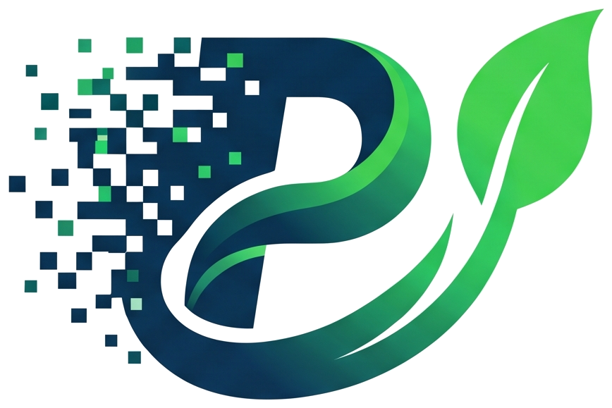

<div align="center">



### Elimina el código muerto de aplicaciones legacy, antes de documentarlas o migrarlas

SonarQube lo encuentra, una IA lo confirma y un motor determinista lo elimina en una copia.<br>
**Tu original nunca se toca.**

[](LICENSE)
[](pyproject.toml)
[](docker-compose.yml)
[](#el-dashboard)

[**Web y demo**](https://nestoralmale24.github.io/PodaAI/?lang=es) · [English](README.md)

</div>


<p align="center"></p>

# Poda AI — tu código legacy, sin peso muerto, listo para migrar

**Poda AI** poda el código muerto de una aplicación legacy antes de documentarla o migrarla. Recibe la aplicación y devuelve:

- una **copia limpia**, sin lo que sobra;
- un **informe** de lo que ha quitado y por qué;
- las **métricas** de la ejecución: tokens, coste, tiempo y líneas eliminadas.

El original no se toca nunca. Todo se maneja desde un **dashboard web**: configuras el proveedor de IA, eliges la aplicación y ves en directo qué lee, qué decide y qué elimina.

Trabaja en tres pasos:

1. **SonarQube**, siempre primero: analiza la aplicación y resume las incidencias de código sin uso.
2. **Análisis propio de Poda AI**: añade lo que SonarQube no ve, como ficheros y directorios que nada alcanza, librerías y dependencias sin uso, o basura y restos de compilación.
3. **La IA** (LiteLLM, GitHub Copilot o tu cuenta de Claude) valida con sus prompts **todos** los hallazgos. Primero hace un triaje con la evidencia reunida y, si no basta, un agente busca en el código con herramientas de solo lectura. Además, busca lo que ninguno de los dos análisis ve.

**Nada se elimina sin la IA**: ni siquiera lo que SonarQube o el análisis propio consideran seguro. La IA nunca edita código: devuelve veredictos, y Poda AI aplica las eliminaciones de forma determinista, byte a byte. Si un fichero deja de ser válido, se revierte.

## Puesta en marcha

1. Copia la carpeta de cada aplicación legacy dentro de `target/`. Ahí está el original, que no se toca; el resultado de cada limpieza queda aparte, en `output/<aplicación>` (ver «Salida»).
2. Levanta los contenedores (Poda AI, su SonarQube y la base de datos de este):

   ```sh
   docker compose up -d --build
   ```

   SonarQube tarda entre 1 y 3 minutos en arrancar la primera vez y necesita unos 2 GB de memoria en Docker.

3. Arranca el dashboard:

   ```sh
   docker exec -it poda-cli poda dashboard
   ```

   Abre `http://127.0.0.1:8770/` en el navegador. `Ctrl+C` cierra el dashboard. Para visualizar el dashboard de sonar abre en `http://127.0.0.1:9001`, con el usuario admin y la contraseña guardada en `poda-settings/providers.json`.


4. Para pararlo todo: `docker compose down`. Los datos de SonarQube se conservan en sus volúmenes.

No hace falta `.env`: todo se configura en el dashboard. Los ajustes opcionales (por ejemplo, `TARGET_DIR` u `OUTPUT_DIR` si las aplicaciones o los resultados están en otra carpeta) están explicados en `.env.sample`. SonarQube tampoco hay que configurarlo: Poda AI lo prepara solo la primera vez (ver «SonarQube», más abajo).

## El dashboard

La página va por pestañas, una por paso, y cada una se desbloquea al completar la anterior. Tiene modo claro y oscuro y se puede usar en inglés (por defecto) o en español con las banderas de arriba a la derecha; se recuerdan en el navegador.

1. **Proveedores de IA** (obligatorio al menos uno):
   - *LiteLLM gateway*: necesita la **URL** del gateway y la **API key**.
   - *GitHub Copilot*: «Conectar con GitHub» (código de un solo uso) o pegar un token OAuth.
   - *Claude*: tu plan Pro/Max con el CLI oficial `claude`. Poda AI mantiene su propia sesión (independiente de la de tu equipo): «Iniciar sesión con Claude», autorizas en la web de Claude y pegas el código. Solo verifica fragmentos (el CLI no tiene herramientas) y cuenta contra el límite de tu plan.
   - Cada proveedor se puede actualizar (lista de modelos), cambiar o quitar, salvo mientras hay una limpieza en marcha: entonces solo se puede cambiar el modelo, que se aplica a la siguiente. Quitar un proveedor es definitivo: se borran la clave o la sesión guardadas, se deja de usar la clave de `.env`, se detiene el proxy de Copilot y, si el modelo elegido era de ese proveedor, también se quita.
2. **Modelo de IA**: proveedor y modelo principal, y un modelo de triaje opcional, más barato. La página muestra qué se usará.
3. **Limpiar una aplicación**:
   - lista las carpetas de `target/` y te deja **elegir una** (si solo hay una, ya está elegida);
   - si la aplicación ya se limpió antes, eliges entre reutilizar las respuestas de la IA (más rápido y sin volver a pagarlas) o empezar de cero;
   - una tarjeta muestra el estado de SonarQube: listo, arrancando o con error;
   - «Iniciar limpieza» solo se activa con un proveedor, un modelo y SonarQube listo.

### Qué hace siempre la limpieza
- **Descubrimiento con IA**, siempre. Además de validar lo que encuentran SonarQube y Poda AI, un agente busca lo que ningún análisis ve:
  - funcionalidades desactivadas para siempre: un *flag* o un parámetro de configuración que siempre vale «apagado»;
  - configuración muerta: mappings, *beans* o rutas que apuntan a clases o páginas que ya no existen;
  - métodos públicos sin uso que el análisis no marcó porque su nombre es muy común;
  - restos: páginas de pruebas o versiones antiguas (`LoginOld`, `*_bak`) a las que nada llega.

  Cada hallazgo llega con las líneas exactas, y Poda AI comprueba que coinciden con el fichero antes de borrar nada.
- **Siempre se escribe la copia limpia.** El original no se toca nunca.
- **Solo se elimina lo que la IA confirma con confianza alta**: buscó por todos los caminos posibles y no encontró ningún uso. Lo de confianza media (queda una vía indirecta que no pudo descartar, como reflexión o una URL llamada desde otro sistema) o baja queda en el informe para revisión manual.

**En directo** se ven:

- las ocho fases, con su progreso, empezando por el análisis y el resumen de SonarQube;
- lo que hace la IA en cada momento: qué busca, qué fichero lee, qué veredictos da;
- cada fichero eliminado y cada bloque de líneas quitado;
- los contadores: hallazgos, veredictos, ficheros, líneas, tokens, coste y tiempo.

«Detener» para la limpieza en cuanto acaba la llamada a la IA en curso. Si se detiene antes de la fase de aplicación, no se escribe la copia limpia; si ya estaba aplicando, termina de aplicar pero no escribe los informes. Las respuestas de la IA ya recibidas quedan guardadas para reutilizarlas. Al acabar una limpieza aparecen el informe, las métricas y el coste, y el registro completo.

Las credenciales quedan en `.poda-settings/` y la sesión de Copilot en `.copilot/`, ambas fuera de git. Nunca se envían al navegador. La página solo es accesible desde el propio equipo (`127.0.0.1`); cada arranque crea una sesión nueva que el navegador guarda en una cookie protegida, sin nada secreto en la dirección.

## Proceso

Al pulsar «Iniciar limpieza», Poda AI recorre ocho fases, siempre en este orden. En el dashboard se ve cada una en directo.

1. **Inventario.** Recorre la aplicación de `target/`, clasifica cada fichero (código, páginas, configuración, build, documentación…), detecta su codificación y cuenta las líneas de código. Deja fuera las salidas de compilación.
2. **SonarQube.** Analiza la aplicación entera solo con reglas de código sin uso y resume lo que encuentra por regla. Sus incidencias quedan guardadas en SonarQube y pasan a la IA como hallazgos. Si SonarQube no puede analizarla, la limpieza se detiene.
3. **Análisis estático de Poda AI.** Añade lo que SonarQube no ve: basura y restos de compilación, ficheros y directorios que nada alcanza, librerías y dependencias sin uso, métodos públicos sin uso, código inalcanzable y código comentado. Si coincide con SonarQube, junta los dos en un solo hallazgo. Todavía no elimina nada.
4. **Contexto (IA).** Un agente estudia cómo arranca y se conecta la aplicación (descriptores, configuración, frameworks) y qué no se debe borrar nunca. Usa también el resumen de SonarQube.
5. **Verificación (IA).** La IA valida uno a uno todos los hallazgos de SonarQube y del análisis propio, sin límite de cantidad: primero ficheros, librerías y dependencias; después, métodos, imports, comentarios y basura de lo que sigue en pie. Cada hallazgo pasa por un triaje con su evidencia y, si no basta, por un agente que busca en el código con herramientas de solo lectura. El veredicto es eliminar, conservar o dejar para revisión, con su confianza y su motivo. Las variables locales, asignaciones y parámetros sin uso que marca SonarQube solo se informan.
6. **Descubrimiento (IA).** Un agente busca lo que ningún análisis ve, como funcionalidades desactivadas para siempre, configuración que apunta a clases que ya no existen o páginas de pruebas, y lo devuelve con las líneas exactas.
7. **Aplicación.** Sobre una copia en `output/<aplicación>`, elimina solo lo que la IA confirma con confianza alta y el contexto no protege. Cada fichero editado se valida y, si queda peor, se revierte.
8. **Informes.** Escribe el informe, las métricas (tokens, coste, tiempo y líneas antes y después), todos los hallazgos con su veredicto y el registro de la ejecución.

## SonarQube
- **No se comparte con nada**: tiene su propia base de datos PostgreSQL, y sus contenedores, red y volúmenes llevan el prefijo `poda`. Aunque en el equipo haya otro SonarQube (por ejemplo, el de una herramienta de seguridad), no se tocan: el de Poda AI publica su interfaz en el puerto **9001**.
- **Versión fija** (`26.11.0.134175`): las versiones nuevas pueden cambiar las reglas que traen por defecto, así que solo se cambia a propósito, comprobando antes que sigue detectando el código muerto.
- **Configuración automática**: la primera vez que está listo, Poda AI cambia la contraseña inicial de `admin` por una aleatoria y crea el token de análisis. Ambos se guardan en `.poda-settings/providers.json` (fuera de git) y nunca se envían al navegador.
- **Qué aporta**: sus reglas de código sin uso (las que tienen la etiqueta `unused`): código comentado, imports, miembros y variables privados, asignaciones que no se usan y código inalcanzable. Lo que detecta pasa a la IA como un hallazgo más, con el mensaje de la regla como evidencia.
- **Solo código muerto**: Poda AI crea en SonarQube el perfil de reglas «Poda AI (código sin uso)», solo con las reglas `unused` de cada lenguaje, y analiza sus proyectos con él. Nada de vulnerabilidades ni de estilo.
- **Se analiza la aplicación entera**: si la aplicación trae su propio `sonar-project.properties` (con exclusiones o carpetas limitadas), se ignora.
- **Sin límite de incidencias**: SonarQube no devuelve más de 10.000 resultados por consulta; si hay más, Poda AI los descarga por lotes de ficheros.
- **Ver las incidencias**: en <http://127.0.0.1:9001>, con el usuario `admin` y la contraseña guardada en `.poda-settings/providers.json`.
- **Si la contraseña de `admin` ya no es la inicial** (por ejemplo, porque la cambiaste a mano), Poda AI no puede prepararlo solo. Crea un token en SonarQube (*My Account → Security*) y ponlo en `SONAR_TOKEN` en `.env`.

## Salida

Cada limpieza deja su resultado en `output/`, separado de los originales de `target/`. Por ejemplo, para `target/<app>`:

```
output/<app>/
├── <app>/                    copia limpia
├── poda_report.md            qué se ha eliminado, por qué y qué queda para revisar
├── execution_metrics.json    tokens, coste, tiempo por fase, llamadas y LOC antes y después
├── execution_metrics.md      lo mismo, en formato legible
├── findings.json             todos los hallazgos, con evidencia, veredicto y estado
├── run.log                   registro completo de la ejecución
└── .poda/                    caché de respuestas de la IA (para reutilizarlas)
```

### Cómo se cuentan las líneas de código

Las «líneas de código» de Poda AI son las de código fuente, páginas, scripts, configuración y build, **sin comentarios, líneas en blanco, documentación ni metadatos del IDE**. Es lo que mide cuánto código real se ha quitado.

Lo que no cuenta se indica aparte, en el inventario y en `execution_metrics.md`, y Poda AI no lo toca:

- documentación (`.md`, `.txt`, `.adoc`…);
- otros ficheros de texto, como los metadatos de Eclipse en `.settings/`.

Por eso la cifra puede ser menor que la de herramientas como cloc, que cuentan el Markdown como código. En los lenguajes que cuentan los dos (Java, XML, `pom.xml`…), las cifras coinciden. Dos detalles menores:

- un fichero que aparece dos veces con el mismo contenido cuenta dos veces, porque los dos se migrarían; cloc cuenta solo uno;
- la línea `#!/bin/sh` de un script cuenta como comentario.

## Qué elimina

Todo lo de esta tabla lo **valida la IA** antes de eliminarlo; la columna indica quién lo detecta.

| Categoría | Ejemplos | Quién lo detecta |
|---|---|---|
| Código comentado | bloques `//`, `/* */`, `<!-- -->`, `'`, `REM` o `*` de COBOL que contienen código | SonarQube y Poda AI |
| Imports sin uso | Java y Python | SonarQube y Poda AI |
| Métodos, funciones y campos sin uso | privados sin uso en su fichero; públicos sin uso en todo el proyecto | SonarQube (privados) y Poda AI (privados y públicos) |
| Código inalcanzable | `if (false)`, `if (DEBUG)` con `DEBUG` constante y falsa, sentencias tras `return` o `throw` | SonarQube y Poda AI (tree-sitter) |
| Basura y artefactos de compilación | core dumps, `Thumbs.db`, `*.bak`, logs, `target/` de Maven, `.class` junto a su `.java` | Poda AI |
| Ficheros y directorios sin uso | clases, JSP, JS, CSS, imágenes y *vendor* que nada vivo alcanza | Poda AI |
| Librerías sin uso | `.jar` que no usan ni el código ni otras librerías | Poda AI (bytecode) |
| Dependencias declaradas sin uso | `pom.xml`, `build.gradle`, `package.json`, `requirements.txt`, `.vbp`, NuGet | Poda AI |
| Lógica y configuración muertas | *flags* siempre apagados, mappings a clases inexistentes, páginas de pruebas | La IA, en el descubrimiento |

Los comentarios explicativos (cómo funciona algo o por qué está así) no se eliminan, porque son conocimiento útil para documentar. Tampoco se toca el interior de las librerías de terceros.

Los prompts están en `poda/prompts/`. Como todo pasa por la IA, también el código comentado evidente, los imports, los miembros privados y la basura, esos hallazgos sencillos van en lotes de 15 por llamada con el modelo de triaje, que es el más barato.

## Coste

`execution_metrics.json` registra cada llamada (fase, modelo, tokens, herramientas, latencia y coste) y los totales; `execution_metrics.md` lo resume.

- **LiteLLM**: gasto real de la clave en el gateway, leído antes y después de la ejecución (si el gateway lo permite); si no, el coste que devuelve el gateway en cada respuesta.
- **Copilot**: desde junio de 2026, GitHub cobra el uso de Copilot en créditos de IA (1 crédito = 0,01 $), por tokens y con la tarifa de cada modelo. Poda AI no puede leer ese consumo, así que lo **estima**: multiplica los tokens de cada llamada (entrada, entrada en caché y salida) por la tarifa que publica GitHub para el modelo. El dashboard lo muestra como «coste estimado (Copilot)», y el selector de modelos enseña la tarifa de cada uno. Es lo que la limpieza descuenta de los créditos de tu plan; no aplica a las suscripciones anuales Pro/Pro+, que siguen pagando por peticiones premium. Las tarifas están en `poda/providers/copilot_pricing.py`, con la fecha en que se copiaron, y hay que actualizarlas cuando GitHub las cambie.

## Estructura

```
poda/
├── dashboard/                  servidor local, página y ejecuciones lanzadas desde ella
├── pipeline.py                 las ocho fases
├── sonar_setup.py              SonarQube local: estado y preparación automática
├── config.py, llm_settings.py  proveedor y modelo (dashboard > .env)
├── core/                       inventario, analizadores, motor LLM, agente, rewriter
├── prompts/                    prompts
├── providers/                  proxy local de Copilot y sus tarifas
├── reporting/                  informe y métricas
└── utils/                      métricas, texto y formato
tests/                          pruebas sin red (LLM y SonarQube simulados)
```

Cómo está hecho por dentro: [guía de desarrollo](docs/DESARROLLO.md).

## Pruebas

```sh
docker exec -it poda-cli python -m unittest discover -s tests -v
```

## Limitaciones

- **Alcanzabilidad por nombre**: es insensible a mayúsculas, así que un nombre muy común puede hacer que algo muerto parezca vivo. Es conservadora a propósito; una segunda pasada tras limpiar suele encontrar más.
- **Lenguajes con miembros**: el análisis estático detecta miembros en Java, C#, JavaScript, TypeScript y Python (con tree-sitter) y en Visual Basic (con expresiones regulares). En COBOL, Delphi y otros lenguajes, solo los busca la IA en la fase de descubrimiento.
- **Usos externos**: lo que llega desde fuera del repositorio (otros sistemas que llaman a una URL, JCL o transacciones definidas fuera) no se puede ver. Esos casos van con confianza baja, y la IA decide con el contexto del proyecto.

## Licencia

[MIT](LICENSE) © 2026 nalmale. Creado y mantenido por [@nestoralmale24](https://github.com/nestoralmale24).
