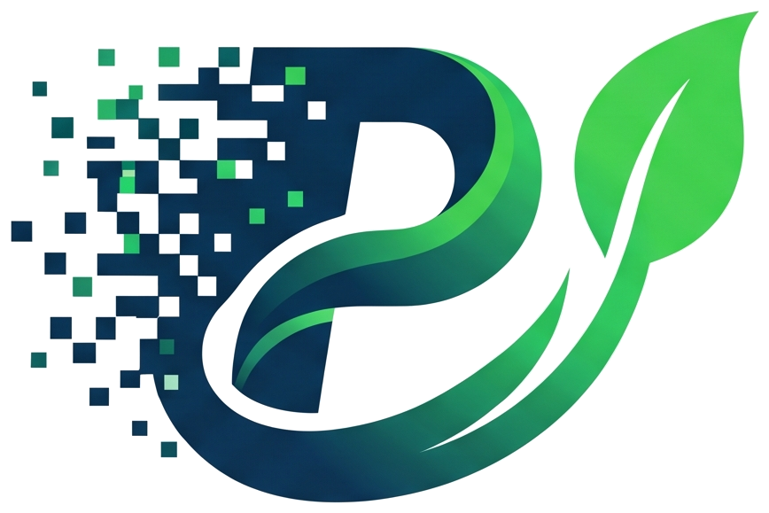
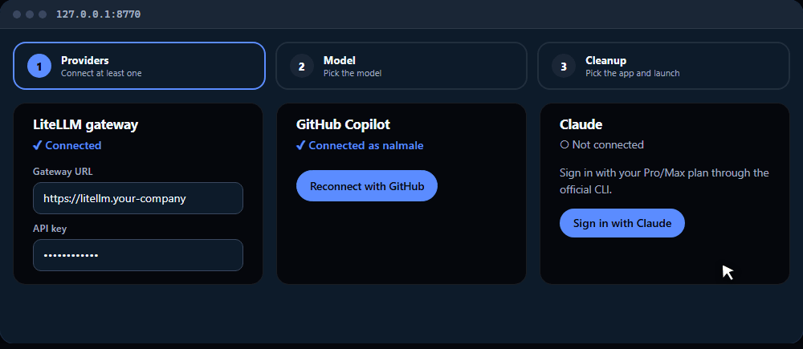
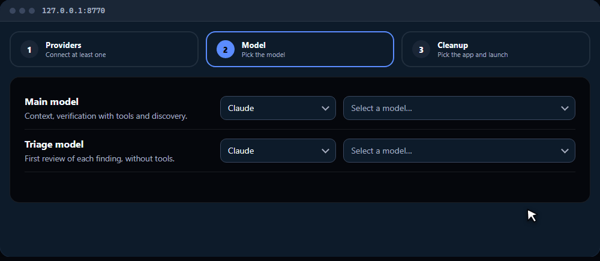
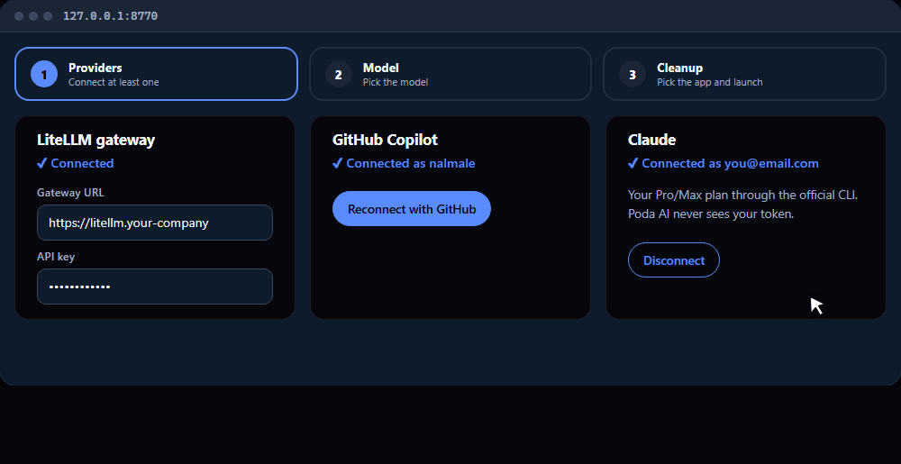
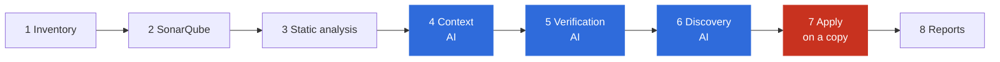

<div align="center">



### Remove the dead code from legacy applications, before you document or migrate them

SonarQube finds it, an AI confirms it, a deterministic engine removes it from a copy.<br>
**Your original is never touched.**

[](LICENSE)
[](pyproject.toml)
[](docker-compose.yml)
[](#bring-your-own-ai)

[**Website & demo**](https://nestoralmale24.github.io/PodaAI/) · [Quick start](#quick-start) · [How it works](#how-it-works) · [Español](README.es.md)

</div>


<p align="center"></p>

## Why Poda AI

Legacy applications carry years of commented-out code, unused libraries, files nobody reaches and features switched off forever. Documenting or migrating all of that wastes time and money. Poda AI removes it first, and it does so carefully:

| | |
| :-- | :-- |
| 🛡️ **Safe by design** | The original is never modified. Every cleanup writes a copy, a report and the metrics under `output/`. |
| 🧠 **The AI only judges** | It returns verdicts (remove, keep, review), never edits. Poda AI applies the deletions byte for byte, and reverts any file that gets worse. |
| 🎯 **Only high confidence** | Anything uncertain goes to the report for manual review. Nothing is removed without the AI, not even what SonarQube considers safe. |
| 🔌 **Bring your own AI** | Claude (Pro/Max account), GitHub Copilot or any LiteLLM gateway, chosen from a local dashboard. |
| 📊 **Full accounting** | Tokens, cost, time and lines of code before and after, for every run. |

## The dashboard

Connect a provider, pick the model, clean an application. Everything is driven from a local web page, in English or Spanish, with light and dark themes. *(Simulated previews of the dashboard.)*

| 1 · Providers | 2 · Model |
| :---: | :---: |
|  |  |
| **3 · Cleanup, live** | **What you get** |
|  | A clean copy of the app, `poda_report.md`, `findings.json`, `execution_metrics.md` and the full `run.log`. [See the output](#output). |

## Quick start

You only need Docker.

1. Copy each legacy application's folder into `target/`. That is where the original lives and it is never touched.
2. Start the containers (Poda AI, its own SonarQube and that one's database):

   ```sh
   docker compose up -d --build
   ```

   SonarQube takes 1 to 3 minutes to start the first time and needs about 2 GB of memory in Docker.

3. Start the dashboard:

   ```sh
   docker exec -it poda-cli poda dashboard
   ```

   It prints the address of the dashboard (`http://127.0.0.1:8770/`) and of SonarQube (`http://127.0.0.1:9001`). Open the dashboard in your browser; `Ctrl+C` closes it.

4. To stop everything: `docker compose down`. SonarQube's data is kept in its volumes.

No `.env` file is needed: everything is configured in the dashboard. The optional settings (for example `TARGET_DIR` or `OUTPUT_DIR`) are explained in `.env.sample`, and SonarQube sets itself up the first time (see [SonarQube](#sonarqube)).

## How it works

Eight phases, always in this order. The dashboard shows each one live.



<details>
<summary><b>What each phase does</b></summary>

<br>

1. **Inventory.** Walks the application in `target/`, classifies every file (code, pages, configuration, build, documentation…), detects its encoding and counts the lines of code. Build outputs are left out.
2. **SonarQube.** Analyses the whole application with only the unused-code rules and summarises what it finds per rule. Its issues are stored in SonarQube and passed to the AI as findings. If SonarQube cannot analyse it, the cleanup stops.
3. **Poda AI static analysis.** Adds what SonarQube cannot see: junk and build leftovers, files and directories that nothing reaches, unused libraries and dependencies, unused public methods, unreachable code and commented-out code. When it matches SonarQube it merges both into a single finding. It does not remove anything yet.
4. **Context (AI).** An agent studies how the application starts and connects (descriptors, configuration, frameworks) and what must never be deleted. It also uses SonarQube's summary.
5. **Verification (AI).** The AI validates every SonarQube and static-analysis finding one by one, with no limit: first files, libraries and dependencies; then methods, imports, comments and junk in what is still standing. Each finding goes through a triage with its evidence and, if that is not enough, through an agent that searches the code with read-only tools. The verdict is remove, keep or review, with its confidence and its reason. Unused local variables, assignments and parameters flagged by SonarQube are only reported.
6. **Discovery (AI).** An agent looks for what no analysis sees, such as features switched off forever, configuration pointing to classes that no longer exist or test pages, and returns it with the exact lines.
7. **Apply.** On a copy in `output/<application>`, removes only what the AI confirms with high confidence and the context does not protect. Every edited file is validated and, if it ends up worse, reverted.
8. **Reports.** Writes the report, the metrics (tokens, cost, time and lines before and after), every finding with its verdict and the run log.

</details>

### What it removes

Everything in this table is **validated by the AI** before being removed.

| Category | Examples | Detected by |
|---|---|---|
| Commented-out code | `//`, `/* */`, `<!-- -->`, `'`, `REM` or COBOL `*` blocks containing code | SonarQube and Poda AI |
| Unused imports | Java and Python | SonarQube and Poda AI |
| Unused methods, functions and fields | private ones unused in their file; public ones unused in the whole project | SonarQube (private) and Poda AI (private and public) |
| Unreachable code | `if (false)`, `if (DEBUG)` with a constant false `DEBUG`, statements after `return` or `throw` | SonarQube and Poda AI (tree-sitter) |
| Junk and build artefacts | core dumps, `Thumbs.db`, `*.bak`, logs, Maven `target/`, `.class` next to its `.java` | Poda AI |
| Unused files and directories | classes, JSPs, JS, CSS, images and vendor code that nothing live reaches | Poda AI |
| Unused libraries | `.jar` files used neither by the code nor by other libraries | Poda AI (bytecode) |
| Unused declared dependencies | `pom.xml`, `build.gradle`, `package.json`, `requirements.txt`, `.vbp`, NuGet | Poda AI |
| Dead logic and configuration | flags that are always off, mappings to missing classes, test pages | The AI, in discovery |

Explanatory comments (how something works or why it is the way it is) are not removed, because they are useful knowledge for documentation. The inside of third-party libraries is not touched either.

## Bring your own AI

| Provider | How you connect | Notes |
|---|---|---|
| **Claude** | "Sign in with Claude" in the dashboard: authorise on the Claude website and paste the code. | Uses your Pro/Max plan through the official `claude` CLI, with its own session (independent of your computer's). Only verifies snippets (the CLI has no tools) and counts against your plan's usage limit. |
| **GitHub Copilot** | "Connect with GitHub" (one-time code) or paste an OAuth token. | Costs are estimated from GitHub's published per-model rates. |
| **LiteLLM gateway** | Gateway **URL** and **API key**. | Any model behind the gateway. From the command line, any LiteLLM provider works (Bedrock, OpenAI, Azure, Gemini…). |

<details>
<summary><b>Dashboard details</b></summary>

<br>

The page is organised in tabs, one per step, and each one unlocks when the previous is complete. Light and dark modes, and English (the default) or Spanish with the flags at the top right; both choices are remembered in the browser.

1. **AI providers** (at least one is required). Each provider can be refreshed (model list), changed or removed, except while a cleanup is running: then only the model can be changed, and it applies to the next one. Removing a provider is permanent: the saved key or session is deleted, the key in `.env` stops being used, the Copilot proxy is stopped and, if the chosen model belonged to that provider, it is removed too.
2. **AI model**: provider and main model, plus an optional, cheaper triage model. The page shows what will be used.
3. **Clean an application**:
   - lists the folders in `target/` and lets you pick one (if there is only one, it is already picked);
   - if the application was cleaned before, you choose between reusing the AI's answers (faster, and you do not pay for them again) or starting from scratch;
   - a card shows SonarQube's state: ready, starting or failed;
   - "Start cleanup" is only enabled with a provider, a model and SonarQube ready.

**Every cleanup** runs the AI discovery (features switched off forever, dead configuration, unused public methods with very common names, leftovers such as `LoginOld` or `*_bak`), always writes the clean copy and only removes what the AI confirms with high confidence. Medium confidence (an indirect path remains that it could not rule out, such as reflection or a URL called from another system) or low confidence stays in the report for manual review.

**"Stop"** halts the cleanup as soon as the AI call in progress finishes. If it is stopped before the apply phase, the clean copy is not written; if it was already applying, it finishes applying but does not write the reports. The AI answers already received are kept so they can be reused.

Credentials are stored in `.poda-settings/` and the Copilot session in `.copilot/`, both outside git and never sent to the browser. The page is only reachable from the machine itself (`127.0.0.1`); every start creates a new session that the browser keeps in a protected cookie, with nothing secret in the address.

</details>

## SonarQube

<details>
<summary><b>How Poda AI runs and uses it</b></summary>

<br>

- **Shared with nothing**: it has its own PostgreSQL database, and its containers, network and volumes carry the `poda` prefix. Even if the machine runs another SonarQube (for example a security tool's), they are not touched: Poda AI's publishes its UI on port **9001**.
- **Pinned version** (`26.11.0.134175`): newer versions can change the rules they ship with, so it is only changed on purpose, after checking that it still detects dead code.
- **Automatic setup**: the first time it is ready, Poda AI replaces the initial `admin` password with a random one and creates the analysis token. Both are stored in `.poda-settings/providers.json` (outside git) and never sent to the browser.
- **Dead code only**: Poda AI creates the "Poda AI (unused code)" rule profile with only the `unused` rules of each language (commented-out code, imports, private members and variables, unused assignments and unreachable code). No vulnerabilities, no style.
- **The whole application is analysed**: if the application ships its own `sonar-project.properties` (with exclusions or limited folders), it is ignored.
- **No issue limit**: SonarQube returns at most 10,000 results per query; if there are more, Poda AI downloads them in batches of files.
- **Browsing the issues**: at <http://127.0.0.1:9001>, signing in as `admin` with the password stored in `.poda-settings/providers.json`.
- **If the `admin` password is no longer the initial one** (for example because you changed it by hand), Poda AI cannot set it up on its own. Create a token in SonarQube (*My Account → Security*) and put it in `SONAR_TOKEN` in `.env`.

</details>

## Output

Every cleanup leaves its result in `output/`, apart from the originals in `target/`. For example, for `target/<app>`:

```
output/<app>/
├── <app>/                    clean copy
├── poda_report.md            what was removed, why, and what is left to review
├── execution_metrics.json    tokens, cost, time per phase, calls and LOC before and after
├── execution_metrics.md      the same, in a readable format
├── findings.json             every finding, with evidence, verdict and status
├── run.log                   full run log
└── .poda/                    AI answer cache (to reuse them)
```

<details>
<summary><b>How lines of code and cost are counted</b></summary>

<br>

**Lines of code.** Poda AI's "lines of code" are those of source code, pages, scripts, configuration and build files, **without comments, blank lines, documentation or IDE metadata**. It is what measures how much real code was removed. What is not counted (documentation such as `.md`, `.txt`, `.adoc`, and other text files such as Eclipse metadata in `.settings/`) is reported separately and Poda AI does not touch it. That is why the figure can be lower than that of tools such as cloc, which count Markdown as code. For the languages both count (Java, XML, `pom.xml`…), the figures match. Two minor details: a file that appears twice with the same content counts twice, because both would be migrated; and the `#!/bin/sh` line of a script counts as a comment.

**Cost.** `execution_metrics.json` records every call (phase, model, tokens, tools, latency and cost) and the totals.

- **LiteLLM**: the key's real spend on the gateway, read before and after the run (if the gateway allows it); otherwise, the cost the gateway returns with each response.
- **Copilot**: since June 2026, GitHub bills Copilot usage in AI credits (1 credit = $0.01), per token and at each model's rate. Poda AI cannot read that consumption, so it **estimates** it from the rate GitHub publishes for each model. The dashboard shows it as "estimated cost (Copilot)". The rates are in `poda/providers/copilot_pricing.py`, with the date they were copied, and must be updated when GitHub changes them.
- **Claude**: it uses your Pro/Max plan, so there is no per-token cost; the usage counts against the plan's limit.

</details>

## Project structure

```
poda/
├── dashboard/                  local server, page and runs launched from it
├── pipeline.py                 the eight phases
├── sonar_setup.py              local SonarQube: status and automatic setup
├── config.py, llm_settings.py  provider and model (dashboard > .env)
├── core/                       inventory, analysers, LLM engine, agent, rewriter
├── prompts/                    prompts
├── providers/                  local Copilot proxy and its rates, Claude CLI transport
├── reporting/                  report and metrics
└── utils/                      metrics, text and formatting
site/                           GitHub Pages website and animated demo
tests/                          network-free tests (simulated LLM and SonarQube)
```

How it is built inside: [development guide](docs/DESARROLLO.md) (in Spanish). Run the tests with:

```sh
docker exec -it poda-cli python -m unittest discover -s tests -v
```

## Limitations

- **Reachability by name**: it is case-insensitive, so a very common name can make something dead look alive. It is conservative on purpose; a second pass after cleaning usually finds more.
- **Languages with members**: the static analysis detects members in Java, C#, JavaScript, TypeScript and Python (with tree-sitter) and in Visual Basic (with regular expressions). In COBOL, Delphi and other languages, only the AI looks for them, in the discovery phase.
- **External uses**: whatever arrives from outside the repository (other systems calling a URL, JCL or transactions defined elsewhere) cannot be seen. Those cases get low confidence, and the AI decides with the project's context.

## License

[MIT](LICENSE) © 2026 nalmale. Created and maintained by [@nestoralmale24](https://github.com/nestoralmale24).

<p align="center"><sub>by</sub> </p>
