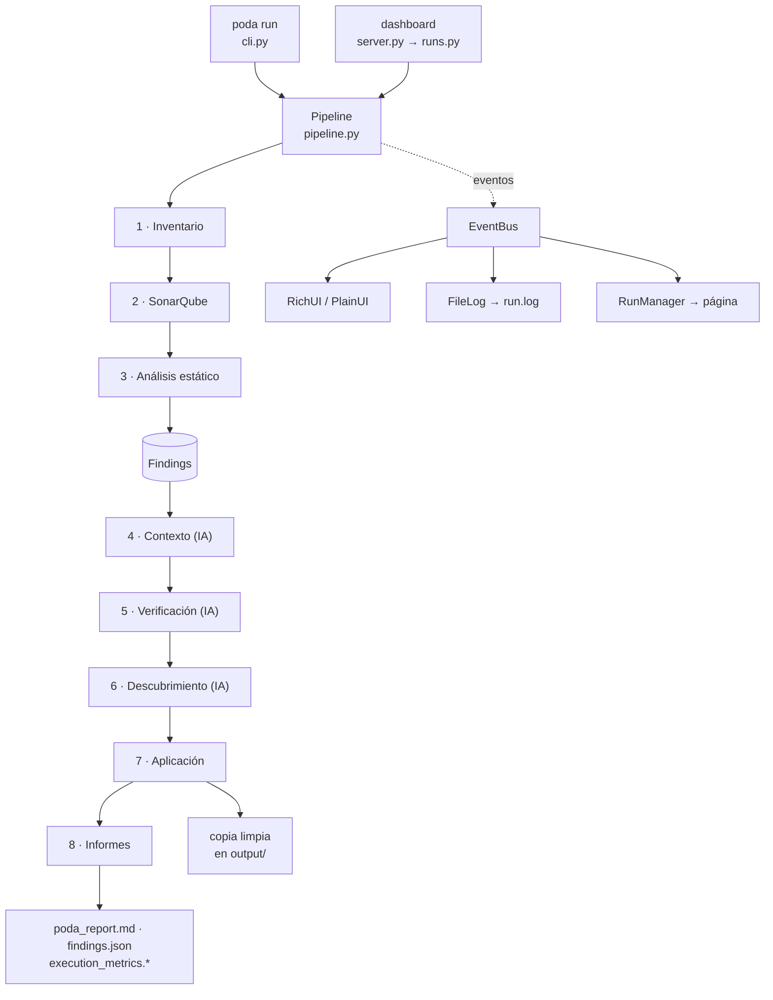

# Guía de desarrollo de Poda AI

Para quien va a cambiar el código de Poda AI. Cómo se usa desde el dashboard, qué elimina y qué deja en `output/` está en el [README](../README.md). Aquí se explica cómo está hecho por dentro y cómo cambiarlo sin romper sus garantías.

[CLAUDE.md](../CLAUDE.md) resume lo mismo en inglés para los asistentes de IA. Si cambias algo de lo que se describe aquí, actualiza los dos.

## Puesta en marcha para desarrollar

Necesitas Python 3.10 o superior (la imagen usa 3.11) y [uv](https://docs.astral.sh/uv/), o Docker.

### En local

```sh
uv venv
uv pip install -r requirements.lock
uv pip install --no-deps -e .
```

Activa el entorno (`source .venv/bin/activate`, o `.venv\Scripts\activate` en Windows) y comprueba que todo funciona:

```sh
python -m unittest discover -s tests -v
python -m poda --version
```

Las pruebas no necesitan red, proveedor de IA ni SonarQube: los simulan.

Desde la CLI, la fase de SonarQube solo se ejecuta con `--sonar`; sin él, la fase 2 se omite y el resto funciona igual. Fuera de Docker, `--sonar` necesita además `SONAR_HOST_URL` y `sonar-scanner` en el `PATH` (o su ruta en `SONAR_SCANNER`); en el contenedor ya vienen los dos.

### Con Docker

```sh
docker compose up -d --build
docker exec -it poda-cli bash
```

El repositorio se monta en `/home/poda/workspace`, así que los cambios de código se ven sin reconstruir. Solo hay que reconstruir (`--build`) si cambian `requirements.lock` o el `Dockerfile`.

### Primera ejecución

Copia una aplicación en `target/` y lanza una vista previa determinista. No llama a la IA, no necesita proveedor ni SonarQube y no escribe la copia limpia:

```sh
python -m poda run target/<app> --no-llm --dry-run --plain
```

Deja el informe en `output/<app>/`. Para repetirla, añade `--force` (empieza de cero) o `--resume` (reutiliza las respuestas de la IA).

Con IA, `python -m poda run target/<app> -y --plain` usa el proveedor configurado en el dashboard o en `.env`. Antes, `python -m poda check --ping` comprueba que el modelo responde con una llamada mínima.

## Tres ideas para entender el código

1. **El hallazgo (`Finding`) es la unidad de trabajo.** Los analizadores lo crean, la IA le pone un veredicto, `rewriter.decide` le asigna una decisión y el aplicador la ejecuta. Todo lo que sale en el informe es un `Finding`.
2. **La IA da veredictos, no edita.** Devuelve JSON que se valida con pydantic. Las eliminaciones las aplica `core/edits.py`, byte a byte y sobre una copia.
3. **El núcleo no imprime.** Todo pasa por `EventBus.emit`. La terminal, `run.log` y el dashboard son suscriptores.

### Garantías que no se pueden romper

| Garantía | Dónde se aplica | Prueba |
|---|---|---|
| El original nunca se modifica | `Pipeline.prepare_output` rechaza una salida dentro del proyecto; `Applier` solo escribe en `output/<app>/<app>/` | `test_run_succeeds_and_writes_every_output`, `test_refuses_output_inside_project` |
| Nada se elimina sin la IA | `pipeline.py`, fase 3: `needs_llm = True` en todo hallazgo con `edit` | `test_nothing_is_removed_without_the_ai` |
| Solo se aplica `remove` con confianza alta (o la de `--min-confidence`) | `rewriter.decide` | `test_decision_policy` |
| Se respetan la codificación y los saltos de línea | `utils/text.py`, `core/edits.py` | `test_encoding_and_line_endings_preserved`, `test_split_lines_keeps_cp1252_bytes` |
| Un fichero que queda peor se revierte | `core/validators.py` | `test_validators_revert_broken_files` |
| Las herramientas del agente solo leen, y solo dentro del proyecto | `core/tools.py` | `test_tools_are_read_only_and_sandboxed` |
| Las pruebas no salen a la red | `tests/fake_llm.py`, `tests/fake_sonar.py` | todas |

## Arquitectura



### Puntos de entrada

Hay dos formas de lanzar una limpieza, y las dos ejecutan el mismo `Pipeline`:

- **`poda run`** (`poda/cli.py`, con Typer): construye `RunOptions` a partir de las opciones, resuelve el proveedor (`config.resolve_llm`), suscribe `RichUI` o `PlainUI` al bus y llama a `Pipeline.run()`. `python -m poda --help` lista los cinco comandos (`run`, `check`, `models`, `login` y `dashboard`) y `python -m poda run --help`, todas sus opciones.
- **El dashboard** (`poda/dashboard/`): `server.py` sirve la página y la API, y `runs.py` (`RunManager`) lanza el pipeline en un hilo y guarda sus eventos para que la página los consulte.

El dashboard fija opciones que en la CLI son libres:

| | `poda run` | Dashboard |
|---|---|---|
| Proveedor de IA | opcional (`--no-llm`) | obligatorio |
| SonarQube | solo con `--sonar` o `--sonar-project-key`; si falla, avisa y sigue | siempre; si no está listo no arranca, y si falla la limpieza se detiene (`sonar_required`) |
| Descubrimiento | se puede omitir (`--no-discover`) | siempre |
| Copia limpia | se puede omitir (`--dry-run`) | siempre |
| Confianza mínima | `--min-confidence` | `high` |
| Ejecuciones a la vez | sin límite | una, que se puede detener |

Códigos de salida de `poda run`:

- `0`: correcto.
- `1`: la IA se detuvo por un error del proveedor. La limpieza termina, pero lo que quedaba por validar va a revisión.
- `2`: configuración u opciones no válidas, o error del pipeline.
- `130`: interrumpida con `Ctrl+C`.

### Las ocho fases

`Pipeline._run` las recorre en orden. Cada una empieza con `_phase(n)`, que comprueba si se pidió detener, y termina con `_end(n, resumen)`.

| # | Fase | Código | Resultado |
|---|---|---|---|
| 1 | Inventario | `core/inventory.py` | `Inventory`: un `FileInfo` por fichero (tipo, sintaxis de comentarios, codificación, si está excluido o es generado) y las carpetas que no se copian |
| 2 | SonarQube | `StaticAnalyzer.run_sonar` → `core/analyzers/sonar.py` | hallazgos con detector `sonar:<regla>` y el resumen por regla |
| 3 | Análisis estático | `StaticAnalyzer.run` | hallazgos propios, fusionados con los de SonarQube |
| 4 | Contexto (IA) | `SemanticValidator.project_context` | `ProjectContext`: puntos de entrada, mecanismos de conexión y patrones `never_remove` |
| 5 | Verificación (IA) | `SemanticValidator.verify` | un veredicto en `finding.llm` |
| 6 | Descubrimiento (IA) | `SemanticValidator.discover` | hallazgos nuevos (detector `llm:discovery`), ya con veredicto |
| 7 | Aplicación | `rewriter.decide` y `edits.Applier` | `decision` y `status` finales, y la copia limpia |
| 8 | Informes | `reporting/report.py`, `reporting/metrics_report.py` | `poda_report.md`, `findings.json` y `execution_metrics.*` |

Las fases 4 a 6 se ejecutan dentro de un único `asyncio.run` (`Pipeline._ai_phases`) y se omiten con `--no-llm`. Además:

- **La verificación va en dos etapas.** Primero, directorios, ficheros, librerías y dependencias (`STAGE_ONE`). Después, el resto, salvo lo que está dentro de un fichero que ya se va a borrar, que pasa a `superseded` sin gastar llamadas.
- **`--max-candidates`** limita cuántos hallazgos van a la IA, empezando por los de `STAGE_ONE`. Los que no caben quedan para revisión. El dashboard no lo usa.
- **Detener** activa `Pipeline.cancel`, un `threading.Event`. Lo comprueban `_phase`, entre fases, y `LLMEngine.complete`, antes de cada llamada, donde se trata como un error fatal.

### El hallazgo (`models.py`)

Campos de `Finding`:

- `category`: una de `CATEGORIES`, que también da el prefijo del id (`FIL-0001`, `MEM-0003`…). Además, `subtype`, `path` (POSIX, relativa a la raíz del proyecto), `start_line`/`end_line` y `symbol`.
- `detectors` (`junk`, `dependencies`, `references`, `imports`, `ast`, `comments`, `sonar:java:S1144`, `llm:discovery`) y `evidence`: lo que la IA recibe como prueba.
- `confidence` y `needs_llm`: la opinión del analizador. Tras la fase 3, el pipeline pone `needs_llm = True` en todo lo que tiene `edit`, así que `confidence` solo llega a la IA como `static_confidence`.
- `edit`, cómo se elimina:
  - `{"op": "delete_path"}`: el fichero o directorio `path`.
  - `{"op": "delete_paths", "paths": [...]}`: varios ficheros, como los `.class` cuyo `.java` está en el proyecto.
  - `{"op": "delete_lines", "ranges": [[s, e], ...], "expect": {"first": ..., "last": ...}, "strip_trailing_comma": [n, ...]}`: líneas. `expect` es opcional; si está, el aplicador comprueba el texto de la primera y la última línea antes de borrar.
  - `None`: solo se informa.
- `llm`: el veredicto (`decision`, `confidence`, `reason`, `evidence` y `mode`, que es `snippet` o `agent`).
- `decision` (`remove`, `keep` o `review`) y `status`, que empieza en `pending` y acaba en `removed`, `kept`, `review`, `failed`, `superseded` o `reported`, con el motivo en `status_detail`.

### Capa estática (`core/static_analyzer.py`)

`StaticAnalyzer.run` ejecuta los analizadores en un orden que importa:

1. **`junk.detect_junk`**: basura y restos de compilación. Va primero porque lo que marca (`inv.junk`) deja de contar como uso de otros ficheros.
2. **`dependencies.DependencyDetector`**: los `.jar` (por su bytecode, también los de dentro de `.war`/`.ear` y de `~/.m2`) y las dependencias declaradas (Maven, Gradle, npm, pip, `.vbp` y NuGet). Va antes de la alcanzabilidad para reconocer las clases del proyecto que tapan una de una librería.
3. **`reachability.detect_unused_code`**: ficheros y directorios que nada vivo alcanza, y miembros e imports sin uso. Usa `RefIndex`, un índice invertido que solo guarda los nombres candidatos. Compara sin distinguir mayúsculas a propósito: así solo puede hacer que algo parezca *más* usado.
4. **`ast_members.detect_unreachable`**: ramas siempre falsas y código tras `return` o `throw`, con tree-sitter (Java, C#, Python, JavaScript y TypeScript). Para extraer miembros de otros lenguajes, como Visual Basic, se usan las expresiones regulares de `legacy_scanners`.
5. **`comments.detect_commented_code`**: bloques de comentarios que puntúan como código.

Al final, `merge_duplicates` junta los hallazgos de línea de la misma categoría que se solapan; por ejemplo, el mismo import marcado por SonarQube y por Poda AI.

Un analizador recibe `(inv, findings)` y cumple estas reglas:

- lee con `inv.text(fi)`, que decodifica y cachea;
- se salta los ficheros con `fi.excluded` o `fi.generated` y los de `inv.junk`;
- añade sus hallazgos con `findings.add()`;
- no escribe nada en disco.

### Capa semántica

| Módulo | Qué hace |
|---|---|
| `core/llm_engine.py` | Es el único módulo que llama a LiteLLM. `complete()` hace una llamada; `judge()` hace una llamada sin herramientas que debe devolver un modelo pydantic, con un intento de reparación |
| `core/agent.py` | `run_agent`: bucle de llamadas con herramientas, con presupuesto de turnos y cierre forzado |
| `core/tools.py` | `ReadOnlyTools`: `grep`, `read_file`, `glob` y `list_dir`, siempre a través del inventario |
| `core/evidence.py` | `EvidenceBuilder.pack`: el paquete de evidencia de cada hallazgo (dónde aparecen sus nombres, el código de alrededor y la cabecera del fichero) |
| `core/semantic.py` | `SemanticValidator`: contexto, verificación y descubrimiento |
| `schemas.py` | los modelos pydantic de cada respuesta: `ProjectContext`, `VerdictBatch` y `DiscoveryBatch` |
| `prompts/*.md` | los prompts, en inglés |

**Verificación: triaje y agente.** Los hallazgos van en lotes de `--batch-size` (15) al modelo de triaje, sin herramientas y con su paquete de evidencia (`verify_snippet.md`). Un hallazgo pasa al agente (`verify_agent.md`, en lotes de `--agent-batch-size`, 5) si no recibió veredicto, si fue `needs_context` o `unsure`, o si fue `remove` sin confianza alta. `commented_code`, `junk` y `unreachable_code` nunca pasan al agente (`SNIPPET_ONLY`). Con `--agent-mode always`, todo lo demás va directo al agente; con `never`, o si el modelo no admite herramientas, todo se queda en el triaje. `--jobs` limita las llamadas en paralelo con un semáforo.

**Errores.** `LLMEngine` distingue dos tipos:

- `LLMFatalError`: credenciales, modelo inexistente, presupuesto agotado, red o certificados (`FATAL_PATTERN`). Se guarda en `engine.fatal` y todas las llamadas siguientes fallan al instante. La limpieza termina sin más veredictos y sale con el código 1.
- `LLMCallError`: falla solo esa llamada. Sus hallazgos se quedan sin veredicto y van a revisión.

En los mensajes de error, la clave del proveedor se sustituye por `***`.

**Salida estructurada.** Si el modelo lo admite, la respuesta se pide con `response_format` (el JSON Schema generado desde `schemas.py`); si el proveedor lo rechaza, se repite la llamada sin él. El JSON se busca en el texto de la respuesta (`extract_json_objects`) y se valida con pydantic. Si no es válido, se pide una corrección con `repair.md`. Si el agente agota los turnos, recibe `finalize.md` con `tool_choice="none"` para que cierre con el JSON.

**Caché y `--resume`.** Cada resultado válido se guarda en `output/<app>/.poda/llm-cache.json`, con una clave SHA-256 del modelo, el modo, el esquema y los mensajes. Solo se lee con `--resume`. Por eso, cambiar un prompt, un esquema o la evidencia invalida la caché de esas llamadas.

**Coste** (`LLMEngine._cost`). Se toma lo primero que haya, en este orden:

1. las tarifas de `--price-in` y `--price-out`;
2. con Copilot, la estimación de `providers/copilot_pricing.py`;
3. la cabecera `x-litellm-response-cost` del gateway;
4. el coste que calcula LiteLLM.

El origen queda en el `cost_source` de cada llamada en `execution_metrics.json`. Con LiteLLM, además, se lee el gasto de la clave antes y después de la ejecución (`/key/info`).

### Aplicación (`core/rewriter.py`, `core/edits.py`, `core/validators.py`)

`decide()` aplica la política en este orden:

1. Las categorías que solo se informan (`info`, `duplicate_library` y `sonar_other`) quedan como `reported`.
2. Un borrado de ruta (salvo `junk`) que coincide con un patrón `never_remove` del contexto queda como `kept`.
3. Lo que no tiene `edit` va a `review`.
4. Un veredicto `remove` con confianza igual o mayor que `--min-confidence` se elimina; `keep` queda como `kept`; cualquier otro, o la falta de veredicto, va a `review`.

`Applier.run()` ejecuta las decisiones `remove`:

1. Borra las rutas, directorios primero. Lo que ya estaba dentro de otro borrado queda `superseded`.
2. Marca como `superseded` los borrados de líneas de los ficheros eliminados.
3. Copia el proyecto en `output/<app>/<app>/`, sin los ficheros eliminados.
4. Borra las líneas fichero a fichero, sobre bytes (`split_lines_b` solo parte por CRLF, LF o CR). Si un rango no existe, o el texto de `expect` no coincide (sin contar diferencias de espacios), ese hallazgo queda `failed`.
5. Valida el resultado con `validators.validate()`, comparándolo con el mismo fichero antes de editarlo: llaves equilibradas, XML y JSON bien formados, Python que compila y no más errores de tree-sitter que antes. Si queda peor, el fichero entero se deja como estaba y sus hallazgos pasan a `failed`.

Con `--dry-run` se calcula todo igual, pero sin escribir.

### Eventos

`EventBus.emit(kind, message, **data)` reparte cada evento a los suscriptores; si uno falla, se ignora para no romper el pipeline. Los tipos de evento y sus datos están documentados al principio de `poda/events.py`.

| Suscriptor | Dónde | Para qué |
|---|---|---|
| `RichUI` | `utils/ui.py` | panel en vivo en la terminal |
| `PlainUI` | `utils/ui.py` | salida línea a línea (`--plain`, o cuando la salida no es una terminal) |
| `FileLog` | `utils/ui.py` | `run.log` |
| `RunManager._collect` | `dashboard/runs.py` | memoria (hasta 20.000 eventos), que la página consulta en `/api/runs/<id>/events` |

Para mostrar algo nuevo, emite un evento (o reutiliza `info`, `detail`, `warn` o `activity`) y, si es un tipo nuevo, dale texto en `event_line()`. Nunca uses `print` en el núcleo.

### Configuración y proveedores

**Precedencia**: opciones de la CLI, luego el dashboard, luego `.env` y por último el entorno del proceso. `config.load_env()` parte del entorno; encima pone `.env` (el de `--env-file`, `$PODA_ENV_FILE` o `<PODA_HOME>/.env`) y encima lo guardado desde el dashboard (`llm_settings.overlay`). `.env` gana al entorno para que editarlo surta efecto sin recrear el contenedor. Las variables `DEADCODE_*` siguen valiendo como `PODA_*`.

`load_env()` devuelve un diccionario: **no copia `.env` en `os.environ`**. Lo que se lee directamente del entorno tiene que estar en el entorno, no en `.env`. Por ejemplo:

- `PODA_HOME`, `PODA_TARGET_DIR`, `PODA_OUTPUT_DIR` y `PODA_SETTINGS_DIR`;
- `PODA_LLM_TRANSPORT`;
- las credenciales que LiteLLM busca por su cuenta, como `OPENAI_API_KEY`.

**`PODA_HOME`** (`config.PROJECT_ROOT`) es donde están `.env`, `.poda-settings/`, `.copilot/`, `target/` y `output/`. Vale `$PODA_HOME`; si no está, la copia del código fuente (si tiene `pyproject.toml`), y si no, `~/.poda`.

**Las carpetas tienen dos juegos de variables**, y es fácil confundirlos:

- `TARGET_DIR` y `OUTPUT_DIR` las lee **docker compose**: qué carpeta del equipo se monta en `target/` y en `output/` del contenedor.
- `PODA_TARGET_DIR` y `PODA_OUTPUT_DIR` las lee **Poda AI**: dónde busca las aplicaciones el dashboard y dónde escribe los resultados. Fuera de Docker son las que cuentan.

**Proveedor.** `config.resolve_llm` devuelve un `LLMConfig`: el proveedor, la cadena de modelo de LiteLLM, el modelo de triaje y, si hacen falta, `api_base` y `api_key`. El proveedor sale de `--provider`, del prefijo de `--model` (`openai/gpt-4o`) o de `LLM_PROVIDER`. Si no hay ninguno, se deduce: si hay clave de LiteLLM, `litellm`; si hay sesión de Copilot, `copilot`. La tabla de proveedores está al principio de `poda/config.py`.

**Copilot.** El proveedor `copilot` usa un proxy local (`providers/copilot_proxy.py`) que `ensure_copilot_proxy` arranca en segundo plano en `127.0.0.1:4142` (`COPILOT_PROXY_PORT`) cuando hace falta:

- habla el formato de Anthropic (`anthropic/<modelo>`);
- se autentica con la clave de `.copilot/proxy-key`;
- escribe su registro en `.copilot/proxy.log`.

`github_copilot` es el proveedor nativo de LiteLLM, sin proxy.

**Ficheros que se guardan**, todos fuera de git:

| Fichero | Contenido | Lo escribe |
|---|---|---|
| `.poda-settings/providers.json` | URL y clave de LiteLLM, modelo elegido, y contraseña de `admin` y token de SonarQube | `llm_settings.py`, `sonar_setup.py` |
| `.poda-settings/<proveedor>-models.json` | caché de la lista de modelos | `llm_settings.py` |
| `.copilot/github-token` | sesión de GitHub Copilot | el dashboard o `poda login copilot` |
| `.copilot/proxy-key`, `.copilot/proxy.log` | clave y registro del proxy local | `copilot_proxy.py` |

### Dashboard

`server.py` es un `ThreadingHTTPServer` de la biblioteca estándar. La página es un único `index.html` con sus `assets/`.

- **Acceso.** Solo responde a los nombres de host permitidos: los de loopback y los de `--allow-host`. Al servir `/`, pone una cookie `poda_session` (`HttpOnly`, `SameSite=Strict`) con un token aleatorio por arranque. Cada llamada a `/api/` debe traerlo en esa cookie o en la cabecera `X-Poda-Token`.
- **Rutas.** Están en la tabla `ROUTES`, al final de `server.py`. Para añadir una, escribe una función `api_x(body, query, *grupos)` que devuelva `(dict, estado)` y añádela a `ROUTES`. Si lanza `LLMSettingsError` o `RunError`, se responde un 400 con su mensaje.
- **Limpiezas.** `RunManager.start` comprueba que hay proveedor y que SonarQube está listo, crea el `Pipeline` y lo lanza en un hilo. `cancel` activa `pipeline.cancel`.
- **Durante una limpieza** no se pueden cambiar ni quitar proveedores. Solo se puede cambiar el modelo, que se usará en la siguiente.

Dentro de Docker, el dashboard escucha en `0.0.0.0` y no abre el navegador; `docker-compose.yml` publica el puerto solo en el `127.0.0.1` del equipo.

### SonarQube

- **`sonar_setup.py`** consulta el estado del SonarQube local y lo prepara la primera vez: cambia la contraseña de `admin` por una aleatoria, crea el token y guarda los dos. Un `SONAR_TOKEN` en el entorno o en `.env` tiene prioridad.
- **`core/analyzers/sonar.py`** trabaja en cada limpieza:
  1. crea o actualiza el perfil «Poda AI (código sin uso)», solo con las reglas que llevan la etiqueta `unused`, y lo asocia al proyecto;
  2. lanza `sonar-scanner` y espera a que SonarQube procese el análisis;
  3. descarga las incidencias, por lotes de 50 ficheros si pasan de 10.000;
  4. con `import_issues`, convierte las reglas de `REMOVABLE` en hallazgos (`commented_code`, `unused_import` y `unused_member`), y el resto en `sonar_other`, que solo se informa.

## Recetas

### Añadir un analizador

1. Crea `poda/core/analyzers/<nombre>.py` con una función `detect_<algo>(inv, findings)` que cumpla las reglas de la capa estática. `junk.py` es el más sencillo, y sirve de modelo.
2. Cada hallazgo necesita:
   - `category` (una de `CATEGORIES`), `subtype` y `path`;
   - `reason`, en español;
   - `detectors=["<nombre>"]` y `evidence`;
   - un `edit`, o `None` si solo se informa.

   En los borrados de líneas, `evidence.py` añade el código de alrededor para `commented_code`, `unused_member`, `unused_import`, `unreachable_code` y `discovered`. Para otras categorías, rellena `snippet`.
3. Llámala desde `StaticAnalyzer.run` con su `_step()` y añade su texto a `STEPS`.
4. Si es una categoría nueva:
   - añádela a `CATEGORIES` en `models.py`, con su prefijo de id;
   - añádela a `CATEGORY_LABEL` en `reporting/report.py`, en español y en inglés;
   - decide si va en `SNIPPET_ONLY` (`core/semantic.py`), en `STAGE_ONE` (`pipeline.py`) y en `merge_duplicates`;
   - explica en `verify_snippet.md` y `verify_agent.md` cómo debe juzgarla la IA.
5. Añade una prueba en `StaticLayer`. Si debe verse en una ejecución completa, añade el caso a `tests/fixtures.py`.

No hace falta nada más para que pase por la IA: el pipeline manda a verificar todo lo que tiene `edit`.

### Cambiar o añadir un prompt

- Los prompts son Markdown en inglés, en `poda/prompts/`. Su primera línea es `<!-- poda-task: nombre -->`, que el LLM simulado de las pruebas usa para decidir qué responder. `system.md`, el mensaje de sistema, no la lleva.
- Los marcadores se escriben `{{EN_MAYUSCULAS}}`. `render()` los rellena de una sola pasada, así que un valor que contenga `{{...}}` (código Mustache o Angular, por ejemplo) se inserta tal cual. Si falta alguno, falla.
- Si cambia la forma de la respuesta, cambia su modelo en `schemas.py` y pasa `schema_text(Modelo)` en `{{SCHEMA}}`. No escribas JSON Schema a mano.
- Un prompt nuevo necesita su respuesta en `transport()` de `tests/fake_llm.py` y su nombre en `test_every_prompt_is_english_and_tagged`.
- Cambiar un prompt invalida la caché de `--resume` de esas llamadas: la siguiente ejecución vuelve a pagarlas.
- Lo que la IA escribe para las personas, como `reason`, sale en el idioma de `OUTPUT_LANGUAGE`, que `system.md` le indica.

### Añadir un proveedor de IA

Puede que no haga falta código: desde la CLI ya funciona cualquier proveedor de LiteLLM con `--provider <proveedor> --model <modelo>` (y `--api-base` si hace falta). Sus credenciales tienen que estar en el entorno del proceso, como `OPENAI_API_KEY`.

Para darle soporte completo, dashboard incluido:

1. En `config.py`, añade su rama en `resolve_llm` (modelo, triaje, `api_base`, credenciales y `display`) y su prefijo en `_qualify`. Si se puede deducir de la configuración, añádelo también en `detect_provider`.
2. En `llm_engine.py`, si LiteLLM no conoce sus modelos, añádelo en `tools_supported`. Si la respuesta no trae el coste, añádelo en `_cost`.
3. Si debe configurarse desde la página, cambia `llm_settings.py` (`PROVIDERS`, el guardado, la lista de modelos y `overlay`), `server.py` e `index.html`.
4. Añade pruebas en `ConfigAndPolicy` y, si toca el dashboard, en `test_dashboard.py`.

### Actualizar las tarifas de Copilot

GitHub cobra Copilot en créditos de IA, por tokens, y Poda AI no puede leer ese consumo: lo estima con una copia de las tarifas. Cuando GitHub las cambie:

1. Actualiza `PRICES` y `PRICES_AS_OF` en `poda/providers/copilot_pricing.py` a partir de `PRICES_URL`.
2. Revisa `test_copilot_rates`.

Un modelo que no está en la tabla queda con coste `None`: no se inventa.

### Cambiar dependencias

Las versiones están fijadas en `pyproject.toml`, y `requirements.lock` las fija con hashes (la imagen instala con `--require-hashes`). Después de cambiar `pyproject.toml`, regenera el lock y reconstruye la imagen:

```sh
uv pip compile pyproject.toml --universal --python-version 3.11 --generate-hashes --no-header -o requirements.lock
```

```sh
docker compose up -d --build
```

Al subir LiteLLM, revisa dos cosas que dependen de su versión y comprueba que pasa `EngineAndAgent`:

- Poda AI pasa `_skip_mcp_handler=True` en cada llamada. Sin él, LiteLLM 1.106 importa el paquete opcional `mcp` cuando hay `tools`.
- Usa la tabla de precios incluida en el paquete (`LITELLM_LOCAL_MODEL_COST_MAP=True`, en `poda/__init__.py`), para no descargarla al arrancar.

### Cambiar la versión de SonarQube

La imagen de SonarQube está fijada en `docker-compose.yml`, y la de SonarScanner, en el `Dockerfile`, con su SHA-256. Una versión nueva puede cambiar qué reglas llevan la etiqueta `unused`. Antes de subirla, limpia una misma aplicación con las dos versiones y compara el resumen por regla de la fase 2.

## Pruebas

```sh
python -m unittest discover -s tests -v
```

En Docker:

```sh
docker exec -it poda-cli python -m unittest discover -s tests -v
```

Para ejecutar una sola clase o prueba, filtra por nombre con `-k`:

```sh
python -m unittest discover -s tests -k test_decision_policy -v
```

| Fichero · clase | Qué cubre |
|---|---|
| `test_poda.py` · `EndToEndWithAI` | una ejecución completa de la CLI, en un subproceso, sobre la aplicación sintética |
| `Modes` | `--no-llm`, `--dry-run`, `--max-candidates`, `--agent-mode never`, la reparación de JSON, `check` y los errores de configuración y de la carpeta de salida |
| `SonarIntegration`, `SonarManyIssues` | la preparación de SonarQube, el perfil, la importación de incidencias y la paginación |
| `EngineAndAgent` | `LLMEngine` y `run_agent`: caché, errores fatales, reparación, turnos y costes |
| `StaticLayer` | analizadores, validadores, herramientas, evidencia y tratamiento del texto |
| `ConfigAndPolicy` | resolución de proveedores, `.env`, política de decisión y prompts |
| `TerminalUI` | `RichUI`, `PlainUI` y `FileLog` |
| `test_dashboard.py` | la API del dashboard, el control de acceso, los proveedores y una limpieza seguida en vivo |

Las piezas de apoyo:

- **`tests/fixtures.py`**: `build_fixture()` crea una aplicación legacy sintética (Java, JSP, `.jar`, cp1252 y basura).
- **`tests/fake_llm.py`** sustituye a LiteLLM con `PODA_LLM_TRANSPORT=fake_llm:transport`. Responde según el `poda-task` del prompt y monta la respuesta con los mocks de LiteLLM, así que el manejo real de tokens, coste y herramientas se ejecuta. Decide por la ruta o el símbolo del candidato:
  - si contiene «keep», lo conserva;
  - si contiene «junit», queda dudoso;
  - si contiene «OldHelper», pide contexto en el triaje, pasa al agente y este lo elimina;
  - todo lo demás lo elimina con confianza alta.
- **`tests/fake_sonar.py`**: un SonarQube simulado (API web y `sonar-scanner` falso) que empieza con `admin`/`admin`, como uno recién instalado.
- **`test_env()`** crea un entorno aislado de tu `.env` y tus credenciales: `PODA_HOME` temporal y un `.env` vacío.

Ninguna prueba sale a la red. Las de extremo a extremo lanzan `python -m poda` en un subproceso, y una tarea de IA nueva necesita su respuesta en `fake_llm.py`.

## Depuración

- **`output/<app>/run.log`**: el registro completo, con el mismo texto que `--plain`.
- **`findings.json`**: cada hallazgo con su veredicto (`llm`), `decision`, `status` y `status_detail`. Es lo primero que hay que mirar cuando algo no se eliminó, o se eliminó algo que no debía.
- **`execution_metrics.json`**: cada llamada a la IA, con fase, modelo, tokens, latencia, coste y error.
- **`python -m poda check --ping`**: comprueba el proveedor, el modelo y el coste con una llamada mínima.
- **`LITELLM_LOG=DEBUG`**: vuelve a mostrar el registro de LiteLLM, que Poda AI silencia porque rompe el panel en vivo.
- **`.copilot/proxy.log`**: los errores del proxy de Copilot.

Para iterar sin gastar mucho:

- `--resume` repite una ejecución sin volver a pagar las respuestas que no han cambiado;
- `--no-discover`, `--agent-mode never` y `--max-candidates N` reducen las llamadas;
- `--triage-model` permite usar un modelo más barato en el triaje.

Errores habituales:

| Mensaje | Causa | Qué hacer |
|---|---|---|
| `… ya existe. Usa --resume … o --force …` | hay una salida anterior en `output/<app>` | `--resume` para reutilizar las respuestas, o `--force` para empezar de cero |
| `… existe y no es una salida de Poda AI` | la carpeta de salida tiene otras cosas | elegir otra con `--out` |
| `La carpeta de salida no puede estar dentro del proyecto analizado.` | `--out` apunta dentro de la aplicación | elegir otra carpeta |
| `No hay ningún proveedor de IA configurado.` | no hay proveedor ni en el dashboard ni en `.env` | configurar uno, o usar `--no-llm` |
| `SonarQube no está listo: …` (dashboard) | está arrancando (de 1 a 3 minutos la primera vez), o alguien cambió a mano la contraseña de `admin` | esperar, o poner un token en `SONAR_TOKEN` en `.env` |

## Convenciones

Las reglas completas están en [CLAUDE.md](../CLAUDE.md). Las más importantes:

- **Idioma.** Los mensajes de la consola y los informes, en español (en inglés si `OUTPUT_LANGUAGE` empieza por «en»). El código, sus comentarios y los prompts, en inglés.
- **Ficheros legacy.** Nunca se vuelven a codificar: se trabaja con bytes y con `utils/text.py`.
- **Ante la duda**, revisión manual.
- **El núcleo no imprime**; usa eventos.
- **Los esquemas de respuesta** se generan desde pydantic.

Las ramas de trabajo se integran en `develop`; `main` es la rama principal.

## Cosas que sorprenden

- **`needs_llm` y `confidence` de los analizadores no deciden nada en una limpieza.** Tras la fase 3, el pipeline obliga a validar con la IA todo lo que tiene `edit`. Las ramas de `decide()` que miran `not f.needs_llm` solo se usan cuando se llama a `decide` fuera del pipeline, como en las pruebas.
- **La alcanzabilidad no distingue mayúsculas**, a propósito. Un nombre muy común puede mantener vivo algo muerto; una segunda pasada tras limpiar suele encontrar más.
- **Ficheros grandes.** Un fichero de más de 6 MB no se lee como texto (`MAX_TEXT_BYTES`): no se busca código muerto dentro de él ni cuenta como referencia a otros. El inventario cachea hasta 512 MB de texto decodificado.
- **La caché de `--resume` depende del texto exacto** de los mensajes. Cualquier cambio en un prompt, en la evidencia o en el contexto del proyecto hace que esas llamadas se repitan.
